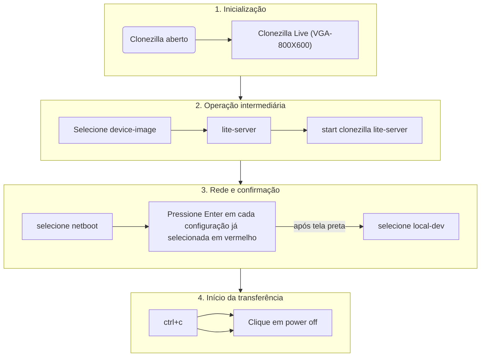

# Clonagem de Estações em Rede com Clonezilla Lite Server — UC 3

* **Aluno:** Helvecio Resende Chaves
* **Tema:** Clonando imagem de disco/sistemas em massa via clonagem remota a partir rede em modo bridge

## 1. Objetivo

* Instalar imagem de disco/sistemas de uma máquina em várias máquinas cliente a partir de uma clonagem remota utilizando o modo multicast de transmissão de dados numa rede com conexão do tipo bridge.

## 2. Ferramentas e Cuidados Técnicos

### **Ferramentas / Softwares:**

* Clonezzila
* Servidor que fornecerá a imagem de disco/sistema remotamente
* Computadores clientes que receberão as imagens imagem de disco/sistema

### **Segurança / Boas Práticas:**

* Backup prévio da imagem de disco/sistema da máquina que irá ser clonada (evita perda caso o disposito estrague ou o arquivo original corrompa)
* Verificação de energia (se possível garanta um ambiente de rede que não está sujeito à variações bruscas/falta de energia elétrica, pois desligar as máquinas durante o processo pode corromper os arquivos)
* As máquinas devem ter um espaço igual ou superior ao tamanho máximo do arquivo descompactado

## 3. Passo a Passo

### Boot do Sistema Operacional de Backup

* No menu BIOS ou UEFI do computador selecione o dispostivo de armazenamento que possui o arquivo imagem de disco/sistema do Clonezilla como meio principal de boot
* Saia do menu BIOS ou UEFI
* Ao fazer o boot automático do disposito selecionado, selecione a primeira opção ao abrir o Clonezilla "English"
* Pressione Enter na opção "Keep default keyboard layout (US)"
* Pressione Enter na opção "Start Clonezilla"

### Representação esquemática do processo dentro do Clonezilla (processo do servidor)



### Representação esquemática do processo dentro do Clonezilla (processo do cliente)

```mermaid
flowchart TB
    subgraph inicio["1. Inicialização"]
        direction LR
        A("Clonezilla aberto") --> B["Clonezilla Live (VGA-800X600)"]
    end

    subgraph operacao["2. Operação intermediária"]
        direction LR
        D["lite-client"]
        D --> E["Pressione Ctrl+C"]
    end

    subgraph rede["3. Rede e confirmação"]
        direction LR
        F["Selecione dhcp"] --> G["Pressione n na tela de sincronização do horário"]
        G --> H["Digite o endereço IP do servidor"]
        H --> I["Pressione Enter em cada configuração já selecionada em vermelho"]
    end

    subgraph finalizacao["4. Após o início da transferência"]
        direction LR
        J["Aguarde o fim da transferência"] --> |"ao concluir"|  K["Clique em power off"]
    end
    
    subgraph inicializacao["5. Pós-transferência"]
        direction LR
        L["desmonte o disco com o sistema do clonezilla"] --> M["Inicie a máquina"] --> N["Teste os recursos básicos da máquina, editores, aplicativos, explorador de arquivos"]
    end

    inicio --> operacao --> rede --> finalizacao --> inicializacao
```

## 4. Como Validar (Teste Final)

* [ ] Teste 1: conferir se os clientes receberam IP via DHCP, as máquinas devem sair da tela preta que mostra um símbolo gerando e vão entrar no modo de espera.
* [ ] Teste 2 ligar as máquinas que receberam a imagem de disco/sistema operacional para conferir se o sistema não está corrompido e se está inicializando corretamente.
